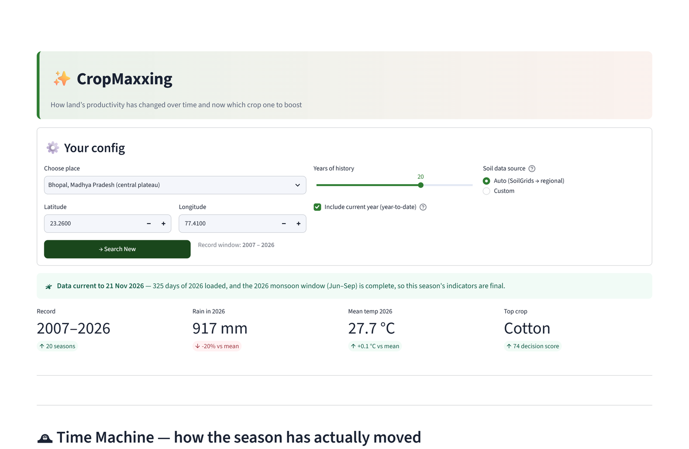
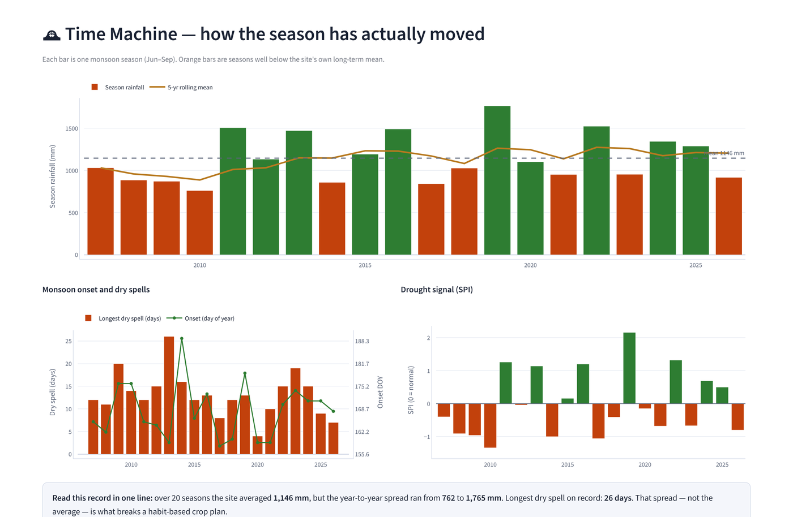
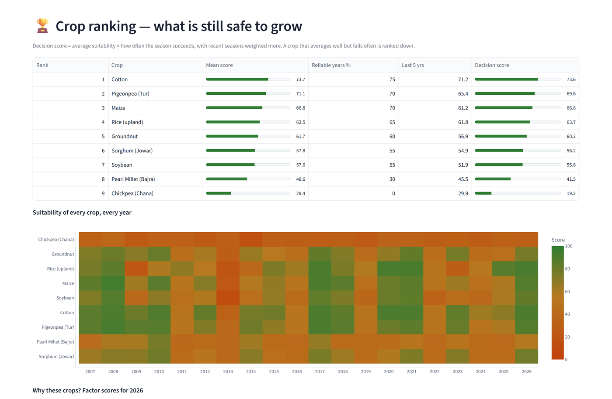
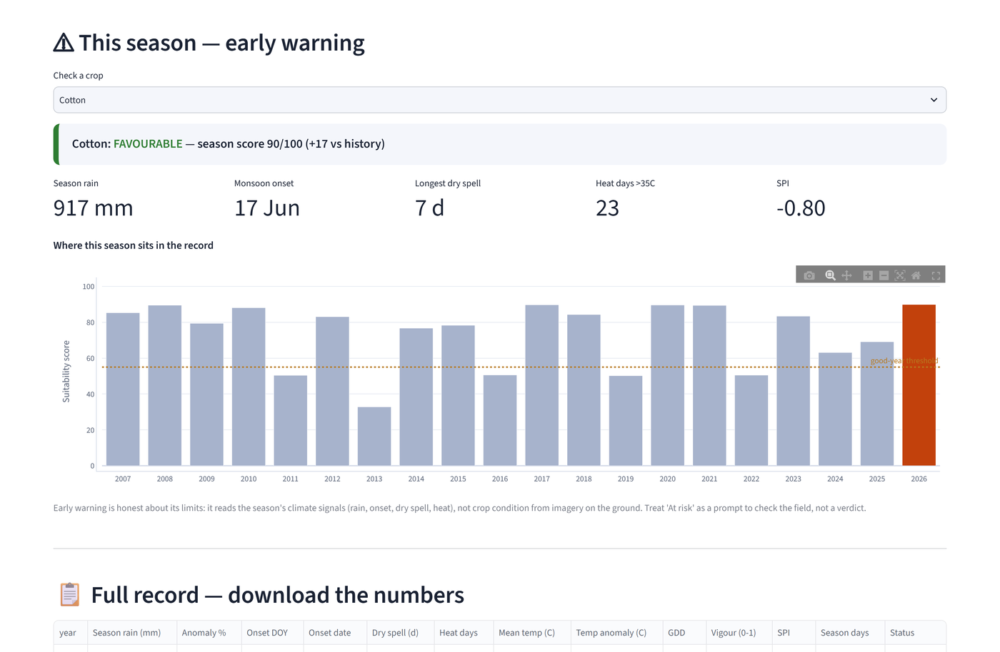
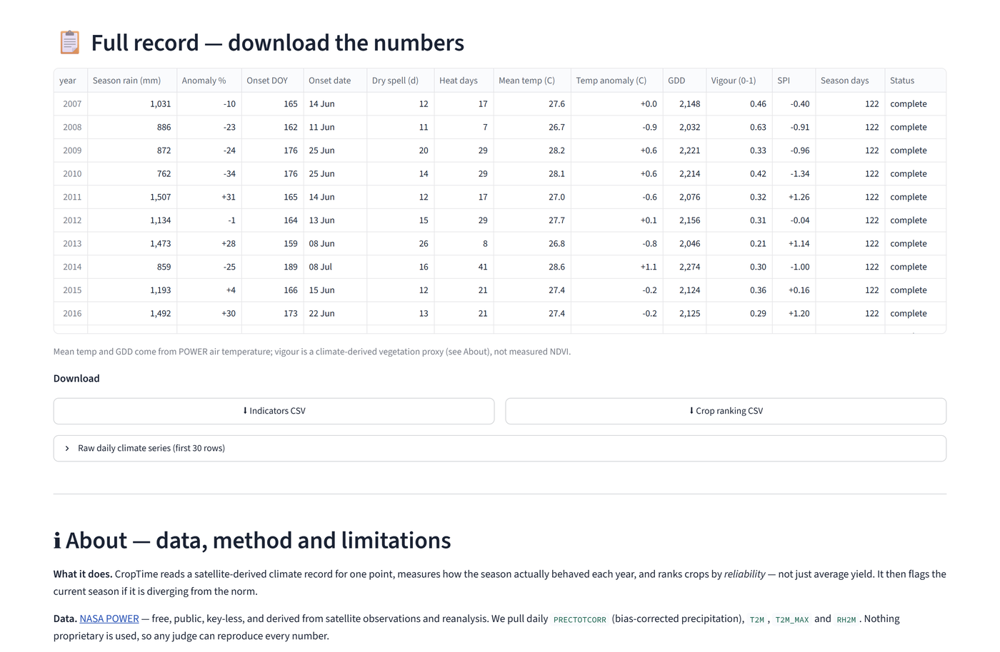
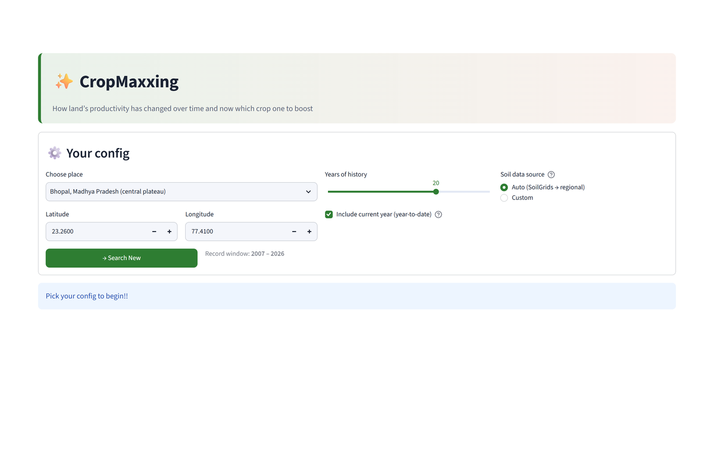

# 🌱 CropMaxxing — Satellite Crop Suitability Advisor

A working prototype built for **ASTRA 2026** (ANTERiX, VIT Bhopal University),
**Domain 2: Earth Observation & Satellite Applications**.

> How your land's productivity has changed over time — and which crop is still
> the safest bet to grow.

<p align="center">
  
</p>

---

## The problem it solves

Ramesh in Nandurbar plants soybean every year because that is what his family
has always done. But the monsoon's timing and volume have shifted, and one
badly-timed season can erase a year's income. Crop choice still rests on habit
and last year's experience — not on what the climate record actually shows, and
not on what the soil under his feet can actually support.

## What it does

1. **Time Machine** — pulls a 20-year satellite-derived climate record for one
   point and shows how the monsoon actually moved: rainfall totals, onset
   dates, dry spells, heat days, drought index.
2. **Crop Ranking** — scores nine candidate crops against that record and ranks
   them by **reliability**, not just average suitability. A crop that averages
   well but fails often is ranked down.
3. **This Season** — compares the current season against the site's own history
   and raises a **Favourable / Watch / At-risk** flag.

---

## Screenshots

Real captures of the running app — not mockups. Regenerate them any time with
`python capture_screens.py`.

### ⚙️ Configuration and headline metrics

Pick a district (or fine-tune coordinates), choose the record length and soil
source, then press **→ Search New**. The banner beneath the button states
exactly how current the data is — here, *"Data current to 21 Nov 2026, and the
2026 monsoon window is complete."*

The KPI strip then reports the record span, this year's rainfall and its
departure from the mean, the mean temperature anomaly, and the top-ranked crop.

*(See the banner image at the top of this README.)*

### 🕰 Time Machine — how the season has actually moved

Season rainfall with a 5-year rolling mean, monsoon onset against the longest
dry spell, and the drought signal (SPI). **The spread, not the average, is what
breaks a habit-based crop plan.**

<p align="center">
  
</p>

### 🏆 Crop ranking — what is still safe to grow

Decision score = average suitability × how often the season succeeds, with
recent seasons weighted more. The heatmap underneath shows every crop against
every year, so 20 seasons fit on one screen.

<p align="center">
  
</p>

### ⚠ This season — early warning

Compares the current season against that crop's own history and raises a flag.
In this capture Cotton scores 90/100 for 2026 — **+17 versus its own history**.

<p align="center">
  
</p>

### 📋 Full record — download the numbers

Every indicator, every year, with CSV export for both the indicator record and
the crop ranking.

<p align="center">
  
</p>

### Landing state

<p align="center">
  
</p>

---

## Quick start

```bash
# 1. Install dependencies
pip install -r requirements.txt

# 2. Run the app
streamlit run app.py
```

Then open <http://localhost:8501>, pick a district in the **⚙️ Your config**
panel, and press **→ Search New**.

No API key, no account, no signup. The app fetches real data on first run and
caches it locally in `croptime/.cache/`, so later runs and offline demos work.

---

## Data: real, free, and reproducible

| Source | Product | What it gives us |
|---|---|---|
| **NASA POWER** (`power.larc.nasa.gov`) | `PRECTOTCORR` | Bias-corrected daily precipitation (mm) |
| | `T2M`, `T2M_MAX` | Mean and maximum 2 m air temperature (°C) |
| | `RH2M` | Relative humidity (%) |

POWER is free, public, key-less and **derived from satellite observations and
reanalysis** — genuinely satellite-based, and any judge can reproduce every
number in the demo.

---

## Scoring model — four weighted factors

Each crop has an agronomic envelope. Every season is scored 0–100 on **four
independent factors**, then combined by weight:

| Factor | Weight | What drives the score | Data source |
|---|---|---|---|
| **Rain** | 35 % | Season rainfall vs the crop's tolerance band | NASA POWER rain |
| **Temperature** | 22 % | Gaussian fit to the crop's optimum mean temp + a GDD window | NASA POWER `T2M` |
| **Vegetation** | 20 % | Canopy vigour, weighted by the crop's water need | Climate-derived vigour index |
| **Soil** | 23 % | pH window × clay/drainage limit × water-holding match | ISRIC SoilGrids |

```
composite = 0.35·rain + 0.22·temp + 0.20·veg + 0.23·soil
season_score = composite × dry_spell_multiplier × onset_multiplier
rank_score   = 0.45·mean + 0.35·(100 × reliability) + 0.20·recent_5yr
```

The weighting reflects rain-fed Indian kharif cropping, where water remains the
dominant driver but temperature, canopy condition and soil each genuinely
change the answer.

### Verified: soil changes the recommendation

Same site (Nandurbar, 2026 season), three different soils:

| Soil | #1 crop | Groundnut soil score |
|---|---|---|
| Heavy black clay (45 % clay, pH 7.9) | Pigeonpea (89.3) | 59.0 |
| Sandy loam (18 % clay, pH 6.9) | **Sorghum** (89.7) | 82.9 |
| Acidic (28 % clay, pH 5.2) | Pigeonpea (83.1) | 46.7 |

Cotton drops from #2 to #3 on sandy soil because it loses its clay advantage;
Groundnut swings 59 → 83 → 47 as the clay limit (38 %) and pH window bite.

Run `python test_factors.py` to reproduce.

### Soil sources, in order

1. **ISRIC SoilGrids** — queried live at the point (250 m, free, no key).
2. **Regional fallback** — a labelled typical soil for the Indian
   agro-climatic zone, used when SoilGrids has a coverage gap.
3. **Manual** — clay / sand / pH sliders under the *Custom* soil option.

The UI **always states which source was used**, so a regional estimate is never
presented as a measurement.

---

## Indicators

| Indicator | Method |
|---|---|
| Season rainfall | Sum of daily rain over the Jun–Sep monsoon window |
| Monsoon onset | First day whose following 7-day total reaches 30 mm (simplified IMD-style rule) |
| Dry spell | Longest consecutive run of days below 2.5 mm inside the season |
| Heat stress | Days with Tmax above 35 °C |
| Mean season temperature | Mean `T2M` across the window, plus anomaly vs the site's own record |
| GDD | Accumulated heat above a 10 °C base across the season |
| Vegetation vigour | 0–1 index from rainfall adequacy, distance from the ~25 °C optimum, dry-spell and heat penalties |
| Soil | Clay / sand / silt, pH, organic carbon → texture class + water-holding index |
| SPI | Standardised rainfall index, mean-zero over the site's own record |

---

## Project layout

```
app.py                       Streamlit UI (single page, 5 sections)
croptime/
  data_fetch.py              NASA POWER client + local disk cache + freshness
  indicators.py              rain, onset, dry spell, heat, temp, GDD, vigour
  crop_model.py              crop envelopes, 4-factor scoring, ranking
  soil.py                    SoilGrids client + regional fallback + manual
.streamlit/config.toml       Light theme; toolbar + Deploy menu hidden
requirements.txt
docs/images/                 Screenshots used in this README
test_engine.py               engine smoke test against live data
test_2026_sites.py           current-year handling across sites
test_factors.py              proves soil changes the recommendation
capture_screens.py           regenerates the screenshots via Playwright + Edge
optimize_shots.py            resizes captures for the README
```

---

## Verified behaviour

The engine was tested against live NASA POWER data for three contrasting
districts. Each produced an agronomically sensible answer:

| District | Mean season rain | Top-ranked crop |
|---|---|---|
| Anantapur, AP (semi-arid) | 382 mm | Chickpea |
| Jodhpur, RJ (arid) | 404 mm | Pearl Millet (Bajra) |
| Nandurbar, MH (cotton belt) | 838 mm | Cotton |

Run `python test_engine.py` to reproduce.

---

### Multi-site check with 2026 data

```bash
python test_engine.py
```

---

## 2026 data support

CropMaxxing is **not limited to completed years**. NASA POWER publishes
near-real-time daily values, and as of **21 Nov 2026** it returns **325 days
of 2026** with **zero missing values across the 122-day monsoon window**.

Because the kharif season closes on 30 September, the **2026 season is already
final** — its rainfall total, onset date, dry spell and heat count cannot
change. That makes 2026 a fully valid, completed season in the ranking, not a
half-finished guess.

### How it works

| Piece | Behaviour |
|---|---|
| `default_range(include_current_year=True)` | Window ends at **today**, so 2026 is fetched |
| `data_fetch.data_freshness(df)` | Reports latest available date, days of the current year, and whether the monsoon window is complete |
| `indicators.build_indicator_table` | Adds `season_days` and `season_complete` per year |
| App banner | Green when the current monsoon is complete, amber when still in progress |
| Config checkbox | Untick *"Include current year"* to fall back to 2006–2025 |

### Verified 2026 result — Nandurbar, Maharashtra

| Year | Season rain | Onset | Dry spell | Heat days | SPI |
|---|---|---|---|---|---|
| 2023 | 748 mm | 27 Jun | 17 d | 22 | −0.30 |
| 2024 | 1,166 mm | 13 Jun | 8 d | 23 | +1.80 |
| 2025 | 620 mm | 17 Jun | 14 d | 15 | −0.95 |
| **2026** | **520 mm** | **3 Jul** | **17 d** | **29** | **−1.45** |

2026 was a **dry, late and hot** season at this site: onset 17 days late,
−36 % rainfall, SPI −1.45. CropMaxxing flags it accordingly — Cotton drops to
**"Watch"** (score 73.6, −19.4 vs its own history) even though it remains the
site's most *reliable* crop overall, while Tur and Sorghum score
**Favourable** because a 520 mm year suits them.

That distinction — reliable crop, bad year — is exactly what a habit-based
decision misses.

---

## Honest limitations

- **SoilGrids coverage.** The public ISRIC mirror has gaps and is
  intermittently degraded. Where it returns nulls the app falls back to a
  **labelled regional soil type**, and the UI always names the source.
- **Vegetation is a proxy.** Vigour is derived from climate signals, not
  measured NDVI. It captures whether the season *allowed* a canopy to develop,
  not what the plants actually looked like. Sentinel-2 NDVI via Earth Engine is
  the direct upgrade.
- **Grid, not field.** POWER is coarsely gridded; it represents an area.
- **Illustrative envelopes.** The crop tolerance bands are agronomically
  reasonable but not yet calibrated against district yield statistics.
- **No economic layer.** It ranks agronomic reliability, not price or market
  risk.

---

## Next steps

- Add Sentinel-2 NDVI and EOS-04 SAR via Google Earth Engine for crop-condition
  validation.
- Calibrate the crop envelopes against district yield statistics (data.gov.in).
- Add Marathi and Hindi advisory text, plus SMS delivery.
- Extend from one point to a block-level grid so agriculture officers can see a
  whole taluka at once.

---

## Regenerating the screenshots

Every image in `docs/images/` is a real capture of the running app, not a mockup.

```bash
# terminal 1 — run the app on a known port
streamlit run app.py --server.port 8520

# terminal 2 — capture, then optimise for the README
python capture_screens.py     # drives Microsoft Edge via Playwright
python optimize_shots.py      # resizes captures to 1400 px wide
```

Requires `pip install playwright`. No browser download is needed — the script
uses the Microsoft Edge already installed on the machine (`channel="msedge"`).

---

<p align="center">
  <b>Built for ASTRA 2026</b> · Domain 2: Earth Observation &amp; Satellite Applications
</p>

